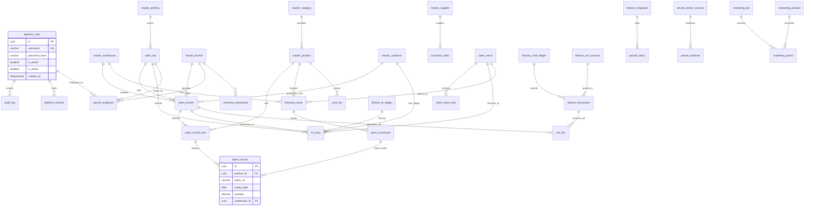

# DATABASE_SCHEMA.md — Medical Company System

## Implemented overlay — AR / Inventory / mapping, 2026-10-17

Migrations `0001`–`0007` are authoritative for the current local database. Planning tables below that are not in this overlay remain unimplemented.

- `inventory.stock_movement` (append-only ledger) and `inventory.stock_balance` (running total per `(warehouse, product, batch)`, `CHECK quantity >= 0`). `inventory.batch_record` gained `UNIQUE (id, warehouse_id)` so a movement cannot move a batch into the wrong warehouse.
- `platform.user_branch(user_id, branch_id)` — the minimum user→branch mapping. Branches own warehouses, so a branch assignment scopes warehouse access. Territories (`user_territory`) and warehouses stay distinct; a territory may map to several branches/warehouses and warehouses may be shared.
- `finance.ar_entry` (append-only): `customer_id`, nullable `invoice_id`, `entry_type` in (`opening`,`invoice`,`payment`,`credit_note`,`adjustment`), `entry_date`, `due_date`, `debit`, `credit`, `reason_id`, `note`, actor/time. `CHECK debit >= 0 AND credit >= 0`, `CHECK debit > 0 OR credit > 0`, `CHECK invoice_id IS NOT NULL OR entry_type != 'invoice'`. Balance = `Σ debit − Σ credit` per customer (matches Excel العملاء `مدين`/`دائن`/`الرصيد`).
- `sales.sales_invoice` gained `posted_by`. Posting gates: `ck_invoice_posting_status` (`Draft`/`Voided`/`Posted`) and `ck_invoice_posted_at` (a Posted row must carry `posted_at`); the old `ck_invoice_posting_disabled` is gone. `ck_invoice_void_metadata` now also permits a `Posted` row (no void metadata). Posting itself stays disabled at the API (409); only `post_invoice_atomic` writes `Posted`.

---

## Implemented overlay — Invoice Slice 1, 2026-10-17

The tables below remain the broader planning schema, not evidence that every module is implemented. Applied migrations `0001`–`0004` are authoritative for the current local database; `docs/INVOICE_SLICE_1.md` describes the tested draft-only contract.

- `master_data.master_product` includes per-product `vat_rate NUMERIC(5,2)`; VAT is snapshotted in invoice lines. The broader category/UOM/brand schema is not implemented by this slice.
- Minimal `master_territory`, `platform.user_territory` assignments, `master_warehouse`, and `inventory.batch_record` are **reference metadata only**. No inventory balances, movements or AR ledger are implemented. Batch reference uniqueness is `(product_id, warehouse_id, batch_no)` in `0004`.
- Invoice header adds `territory_id`, integer `version`, `updated_at`, `updated_by`, `voided_by`. Header customer/branch/warehouse/creator and line product are required; source warehouse has a composite branch FK. Lines have stable ordering via `line_no`; product/batch FK is enforced.
- PostgreSQL constraint `ck_invoice_posting_disabled` permits **Draft/Voided only and NULL posted_at**. API posting always rejects; posted reversal is unavailable. Future atomic stock+AR posting needs a deliberate later migration, not a runtime toggle.
- Current 2-decimal half-up calculator is a **draft policy inherited from Piece 1**, not verified printed-invoice rounding or permission to round source migrations. Header totals must satisfy `before_discount − discount = grand_total` and `total_net + vat_amount = grand_total`.
- The older payroll formulas in §§7/11 and D18 are **UNVERIFIED and mutually inconsistent with the observed layout**. No salary formula is approved or implemented. Net-price formula `E=C×(1−D)` is in the named warehouse transaction sheets, **not** `كامل الكمية` (whose opening-value total uses `E=C×D`).

---

**Generated:** 2026-10-16  
**Authoritative sources:** DATA_DICTIONARY.md, EXCEL_TO_SYSTEM_MAPPING.md, DECISION_LOG.md, MODULE_MAP.md  
**PostgreSQL · PWA · Arabic/English RTL**

---

## 1. ER Diagram (Mermaid — 25 core entities)



---

## 2. Platform Module (schema: `platform`)

| Table | Columns | Types | PK/FK/Unique | Notes |
|-------|---------|-------|--------------|-------|
| `platform_user` | id, username, password_hash, first_name, last_name, role, is_owner, is_active, created_at, updated_at | uuid, varchar(60), varchar(255), varchar(100), varchar(100), varchar(30), boolean, boolean, timestamptz, timestamptz | PK: id; UK: username | D10: owner-only boundary via `is_owner` flag + RLS |
| `platform_session` | id, user_id, device_info, ip_address, created_at, expires_at | uuid, uuid(FK→platform_user), text, inet, timestamptz, timestamptz | PK: id; FK: user_id | Auth sessions |
| `platform_setting` | key, value, description, updated_by, updated_at | varchar(60), text, text, uuid(FK), timestamptz | PK: key; FK: updated_by | Fiscal year, VAT rate, company info, currency |

---

## 3. Master Data Module (schema: `master_data`)

| Table | Columns | Types | PK/FK/Unique | Notes |
|-------|---------|-------|--------------|-------|
| `master_branch` | id, code, name_ar, name_en, territory_id, created_at | uuid, varchar(20), varchar(100), varchar(100), uuid(FK→master_territory), timestamptz | PK: id; UK: code | 5 branches: 6 أكتوبر, الدقهليه, الشرقية, الغربية, الفيوم (D17) |
| `master_territory` | id, code, name_ar, name_en | uuid, varchar(20), varchar(100), varchar(100) | PK: id; UK: code | |
| `master_product` | id, sku, name_ar, name_en, category_id, brand, base_price, default_discount_pct, uom_id, is_active, created_at | uuid, varchar(50), varchar(200), varchar(200), uuid(FK→master_category), varchar(100), decimal(12,2), decimal(5,2), uuid(FK→master_uom), boolean, timestamptz | PK: id; UK: sku | UOM discovery-gated (D13); discount ~0.28–0.30 observed |
| `master_category` | id, code, name_ar, name_en | uuid, varchar(30), varchar(100), varchar(100) | PK: id; UK: code | |
| `master_uom` | id, code, name_ar, name_en, conversion_factor | varchar(20), varchar(20), varchar(50), varchar(50), decimal(10,4) | PK: code | box/pack/unit only if used (D13) |
| `master_customer` | id, code, name_ar, name_en, customer_type, branch_id, territory_id, rep_id, contact_phone, address, credit_limit, aging_bucket, status, created_at | uuid, varchar(30), varchar(200), varchar(200), varchar(30), uuid(FK→master_branch), uuid(FK→master_territory), uuid(FK→sales_rep), varchar(30), text, decimal(14,2), varchar(20), varchar(20), timestamptz | PK: id; UK: code; FK branch_id, territory_id, rep_id | D21: ~48 customer blocks in AR ledger |
| `master_supplier` | id, code, name_ar, name_en, contact_phone, address, status | uuid, varchar(30), varchar(200), varchar(200), varchar(30), text, varchar(20) | PK: id; UK: code | Purchasing discovery-gated (D11) |
| `master_warehouse` | id, branch_id, code, name_ar, name_en, is_active | uuid, uuid(FK→master_branch), varchar(30), varchar(100), varchar(100), boolean | PK: id; UK: (branch_id, code) | Territory vs source warehouse (V2 feature 1) |
| `master_sales_rep` | id, code, name_ar, name_en, branch_id, phone, is_active, created_at | uuid, varchar(30), varchar(100), varchar(100), uuid(FK→master_branch), varchar(30), boolean, timestamptz | PK: id; UK: code; FK branch_id | |
| `master_partner` | id, code, name_ar, name_en, share_pct, is_active | uuid, varchar(30), varchar(200), varchar(200), decimal(5,2), boolean | PK: id; UK: code | For Balance Sheet capital/partners section |

---

## 4. Sales Module (schema: `sales`)

| Table | Columns | Types | PK/FK/Unique | Notes |
|-------|---------|-------|--------------|-------|
| `sales_invoice` | id, invoice_no, branch_id, warehouse_id, customer_id, rep_id, invoice_date, posting_status, total_before_discount, total_discount, total_net, vat_amount, grand_total, notes, created_at, created_by, posted_at, voided_at, void_reason_id | uuid, varchar(30), uuid(FK→master_branch), uuid(FK→master_warehouse), uuid(FK→master_customer), uuid(FK→master_sales_rep), date, varchar(20), decimal(14,2), decimal(14,2), decimal(14,2), decimal(14,2), decimal(14,2), text, timestamptz, uuid(FK→platform_user), timestamptz, timestamptz, uuid(FK→reason_code) | PK: id; UK: (branch_id, invoice_no); FK: branch_id, warehouse_id, customer_id, rep_id, created_by, void_reason_id | Posting status: Draft → Posted → Voided (D14); soft-delete on void |
| `sales_invoice_line` | id, invoice_id, product_id, batch_id, quantity, unit_price, discount_pct, net_price, line_total, vat_rate, vat_amount, notes | uuid, uuid(FK→sales_invoice), uuid(FK→master_product), uuid(FK→batch_record), decimal(12,3), decimal(12,2), decimal(5,2), decimal(12,2), decimal(14,2), decimal(5,2), decimal(14,2), text | PK: id; FK: invoice_id, product_id, batch_id | Net price: **E = C × (1 − D)** (D18, observed formula) |
| `sales_invoice_vat_line` | id, invoice_line_id, vat_rate, taxable_amount, vat_amount | uuid, uuid(FK→sales_invoice_line), decimal(5,2), decimal(14,2), decimal(14,2) | PK: id; FK: invoice_line_id | V2 feature 6: VAT lines |
| `sales_return` | id, return_no, invoice_id, return_date, warehouse_id, reason_id, status, total_net, created_at, created_by | uuid, varchar(30), uuid(FK→sales_invoice), date, uuid(FK→master_warehouse), uuid(FK→reason_code), varchar(20), decimal(14,2), timestamptz, uuid(FK→platform_user) | PK: id; UK: (warehouse_id, return_no); FK: invoice_id, warehouse_id, reason_id, created_by | V2 feature 11: explicit return transactions |
| `sales_return_line` | id, return_id, product_id, batch_id, quantity, net_price, line_total | uuid, uuid(FK→sales_return), uuid(FK→master_product), uuid(FK→batch_record), decimal(12,3), decimal(12,2), decimal(14,2) | PK: id; FK: return_id, product_id, batch_id | |
| `sales_sold_balance` | id, customer_id, rep_id, invoice_line_id, batch_id, sale_date, quantity, unit_price, discount_pct, net_price, debit, credit, running_balance, document_ref, created_at | uuid, uuid(FK→master_customer), uuid(FK→master_sales_rep), uuid(FK→sales_invoice_line), uuid(FK→batch_record), date, decimal(12,3), decimal(12,2), decimal(5,2), decimal(12,2), decimal(14,2), decimal(14,2), decimal(14,2), varchar(200), timestamptz | PK: id; FK: customer_id, rep_id, invoice_line_id, batch_id | Mapped from `رصيد الارصدة المباعة` (~64–74×97–101, 1100–1267 formulas); running balance = prev + debit − credit |
| `sales_branch_rollup` | id, branch_id, warehouse_id, product_id, month_year, quantity_in, quantity_out, quantity_balance, revenue_gross, revenue_net, discount_total, created_at, computed_at | uuid, uuid(FK→master_branch), uuid(FK→master_warehouse), uuid(FK→master_product), date, decimal(12,3), decimal(12,3), decimal(12,3), decimal(14,2), decimal(14,2), decimal(14,2), timestamptz, timestamptz | PK: id; UK: (branch_id, warehouse_id, product_id, month_year); FK: branch_id, warehouse_id, product_id | Snapshot table; fed from posted invoices monthly (V2 feature 3) |
| `sales_target` | id, branch_id, rep_id, product_id, month_year, target_qty, target_value, actual_qty, actual_value, created_at | uuid, uuid(FK→master_branch), uuid(FK→master_sales_rep), uuid(FK→master_product), date, decimal(12,3), decimal(14,2), decimal(12,3), decimal(14,2), timestamptz | PK: id; FK: branch_id, rep_id, product_id | V2 feature 12: sales targets |

---

## 5. Inventory Module (schema: `inventory`)

| Table | Columns | Types | PK/FK/Unique | Notes |
|-------|---------|-------|--------------|-------|
| `inventory_stock` | id, warehouse_id, product_id, batch_id, qty_on_hand, qty_allocated, qty_available, last_cost, updated_at | uuid, uuid(FK→master_warehouse), uuid(FK→master_product), uuid(FK→batch_record), decimal(12,3), decimal(12,3), decimal(12,3), decimal(12,2), timestamptz | PK: id; UK: (warehouse_id, product_id, batch_id); FK: warehouse_id, product_id, batch_id | V2 feature 8: hide zero-qty lines |
| `stock_movement` | id, movement_no, warehouse_id, product_id, batch_id, movement_type, quantity, source_invoice_id, target_invoice_id, movement_date, notes, created_at, created_by | uuid, varchar(30), uuid(FK→master_warehouse), uuid(FK→master_product), uuid(FK→batch_record), varchar(30), decimal(12,3), uuid(FK→sales_invoice), uuid(FK→sales_invoice), date, text, timestamptz, uuid(FK→platform_user) | PK: id; UK: (warehouse_id, movement_no); FK: warehouse_id, product_id, batch_id, source_invoice_id, target_invoice_id, created_by | In/out transfers, returns, adjustments |
| `batch_record` | id, product_id, warehouse_id, batch_no, manufacture_date, expiry_date, qty_received, qty_remaining, created_at | uuid, uuid(FK→master_product), uuid(FK→master_warehouse), varchar(50), date, date, decimal(12,3), decimal(12,3), timestamptz | PK: id; UK: (product_id, batch_no); FK: product_id, warehouse_id | V2 features 7–8: batch + expiry tracking |
| `inventory_transfer` | id, transfer_no, source_warehouse_id, target_warehouse_id, transfer_date, status, created_at, created_by | uuid, varchar(30), uuid(FK→master_warehouse), uuid(FK→master_warehouse), date, varchar(20), timestamptz, uuid(FK→platform_user) | PK: id; UK: (source_warehouse_id, transfer_no); FK: source_warehouse_id, target_warehouse_id, created_by | V2 feature 3: inter-warehouse transfers |

---

## 6. Finance Module (schema: `finance`)

| Table | Columns | Types | PK/FK/Unique | Notes |
|-------|---------|-------|--------------|-------|
| `finance_coa_account` | id, code, name_ar, name_en, account_type, parent_id, is_active | uuid, varchar(20), varchar(200), varchar(200), varchar(20), uuid(FK→finance_coa_account), boolean | PK: id; UK: code; FK: parent_id (self-ref) | Minimal COA (D14) |
| `finance_transaction` | id, txn_no, txn_date, txn_type, description, branch_id, warehouse_id, customer_id, supplier_id, rep_id, debit, credit, running_balance, posted_to_account_id, related_invoice_id, status, created_at, created_by | uuid, varchar(30), date, varchar(30), text, uuid(FK→master_branch), uuid(FK→master_warehouse), uuid(FK→master_customer), uuid(FK→master_supplier), uuid(FK→master_sales_rep), decimal(14,2), decimal(14,2), decimal(14,2), uuid(FK→finance_coa_account), uuid(FK→sales_invoice), varchar(20), timestamptz, uuid(FK→platform_user) | PK: id; UK: (branch_id, txn_no); FK: branch_id, warehouse_id, customer_id, supplier_id, rep_id, posted_to_account_id, related_invoice_id, created_by | Normalized journal entries |
| `finance_ar_ledger` | id, customer_id, entry_date, rep_id, description, debit, credit, running_balance, source_type, source_id, created_at | uuid, uuid(FK→master_customer), date, uuid(FK→master_sales_rep), text, decimal(14,2), decimal(14,2), decimal(14,2), varchar(30), varchar(50), timestamptz | PK: id; FK: customer_id, rep_id | D23: normalized from 47×747 wide sheet (~48 customer blocks × 6 cols); running balance: opening D=E−F, then D=prev+E−F; row-1 total = 2,200,000 |
| `finance_cash_ledger` | id, txn_no, txn_date, description, debit, credit, running_balance, account_id, status, created_at, created_by | uuid, varchar(30), date, text, decimal(14,2), decimal(14,2), decimal(14,2), uuid(FK→finance_coa_account), varchar(20), timestamptz, uuid(FK→platform_user) | PK: id; UK: (account_id, txn_no); FK: account_id, created_by | Mapped from `النقديه` (40×24, 272 formulas) |
| `finance_pnl_summary` | id, branch_id, period_year, period_month, revenue_total, cost_total, expense_total, net_profit, created_at, computed_at | uuid, uuid(FK→master_branch), date, decimal(14,2), decimal(14,2), decimal(14,2), decimal(14,2), timestamptz, timestamptz | PK: id; UK: (branch_id, period_year, period_month); FK: branch_id | Snapshot; computed from transactions |
| `finance_balance_sheet` | id, branch_id, as_of_date, total_assets, total_liabilities, total_equity, net_profit_year_to_date, retained_earnings, market_value, created_at, computed_at | uuid, uuid(FK→master_branch), date, decimal(14,2), decimal(14,2), decimal(14,2), decimal(14,2), decimal(14,2), decimal(14,2), timestamptz, timestamptz | PK: id; UK: (branch_id, as_of_date); FK: branch_id | Aggregate from BS sheets |
| `finance_fixed_asset` | id, asset_no, name_ar, acquisition_date, acquisition_cost, accumulated_depreciation, net_book_value, status, branch_id, created_at | uuid, varchar(30), varchar(200), date, decimal(14,2), decimal(14,2), decimal(14,2), varchar(20), uuid(FK→master_branch), timestamptz | PK: id; UK: asset_no; FK: branch_id | Mapped from `الاصول الثابته` |
| `finance_current_asset` | id, asset_no, name_ar, value, category, branch_id, created_at | uuid, varchar(30), varchar(200), decimal(14,2), varchar(50), uuid(FK→master_branch), timestamptz | PK: id; UK: asset_no; FK: branch_id | Mapped from `الاصول المتغيره` |
| `finance_payment` | id, payment_no, payment_date, payment_method, amount, customer_id, rep_id, description, branch_id, status, created_at, created_by | uuid, varchar(30), date, varchar(30), decimal(14,2), uuid(FK→master_customer), uuid(FK→master_sales_rep), text, uuid(FK→master_branch), varchar(20), timestamptz, uuid(FK→platform_user) | PK: id; UK: (branch_id, payment_no); FK: customer_id, rep_id, branch_id, created_by | Collections/payment receipts |

---

## 7. Payroll Module (schema: `payroll`)

| Table | Columns | Types | PK/FK/Unique | Notes |
|-------|---------|-------|--------------|-------|
| `payroll_employee` | id, branch_id, customer_id (alias for rep), name_ar, name_en, basic_salary, dubai_allowance, dopay_allowance, target_pct, deductions, net_salary, status, created_at | uuid, uuid(FK→master_branch), uuid(FK→master_customer), varchar(100), varchar(100), decimal(12,2), decimal(12,2), decimal(12,2), decimal(5,2), decimal(12,2), decimal(12,2), varchar(20), timestamptz | PK: id; FK: branch_id, customer_id (rep) | D9: lightweight — salary records/payments only; net = B−C−D (D18) |
| `payroll_payment` | id, employee_id, payment_date, amount, payment_method, notes, created_at, created_by | uuid, uuid(FK→payroll_employee), date, decimal(12,2), varchar(30), text, timestamptz, uuid(FK→platform_user) | PK: id; FK: employee_id, created_by | |

---

## 8. Marketing Module (schema: `marketing`)

| Table | Columns | Types | PK/FK/Unique | Notes |
|-------|---------|-------|--------------|-------|
| `marketing_kol` | id, code, name_ar, name_en, specialty, branch_id, contact_phone, is_active, created_at | uuid, varchar(30), varchar(200), varchar(200), varchar(100), uuid(FK→master_branch), varchar(30), boolean, timestamptz | PK: id; UK: code; FK: branch_id | D22: Sheet1 in حسابات خاصه = doctor/KOL list |
| `marketing_spend` | id, kol_id, product_id, spend_date, amount, objective, kpi_metric, kpi_value, branch_id, notes, created_at, created_by | uuid, uuid(FK→marketing_kol), uuid(FK→master_product), date, decimal(14,2), varchar(50), varchar(50), decimal(12,2), uuid(FK→master_branch), text, timestamptz, uuid(FK→platform_user) | PK: id; FK: kol_id, product_id, branch_id, created_by | V2 features 16–18: KOL spend, product/brand-linked spend, objective + KPI |

---

## 9. Private / Owner Accounts Module (schema: `private_accounts`)

| Table | Columns | Types | PK/FK/Unique | Notes |
|-------|---------|-------|--------------|-------|
| `private_owner_account` | id, code, name_ar, name_en, account_type, is_active, created_at | uuid, varchar(30), varchar(200), varchar(200), varchar(30), boolean, timestamptz | PK: id; UK: code | D10: same DB, separate schema, RLS owner-only |
| `private_expense` | id, owner_account_id, expense_date, amount, category, description, branch_id (null=global), receipt_ref, created_at, created_by | uuid, uuid(FK→private_owner_account), date, decimal(14,2), varchar(50), text, uuid(FK→master_branch), varchar(50), timestamptz, uuid(FK→platform_user) | PK: id; FK: owner_account_id, branch_id, created_by; created_by must be owner | Mapped from `مصاريفى` (272×109) |
| `private_partner_account` | id, partner_id, account_date, debit, credit, running_balance, description, created_at | uuid, uuid(FK→master_partner), date, decimal(14,2), decimal(14,2), decimal(14,2), text, timestamptz | PK: id; FK: partner_id | Mapped from `الحاج علاء` (97×8) |
| `private_project_account` | id, project_id, account_date, debit, credit, running_balance, description, created_at | uuid, uuid, date, decimal(14,2), decimal(14,2), decimal(14,2), text, timestamptz | PK: id | Mapped from `الشركة الجديدة` (876×26) |
| `private_property_account` | id, property_id, account_date, debit, credit, running_balance, description, created_at | uuid, uuid, date, decimal(14,2), decimal(14,2), decimal(14,2), text, timestamptz | PK: id | Mapped from `الشالية مارينادلتا` (60×24) |
| `private_monthly_summary` | id, owner_account_id, period_year, period_month, total_debit, total_credit, net_balance, created_at | uuid, uuid(FK→private_owner_account), integer, integer, decimal(14,2), decimal(14,2), decimal(14,2), timestamptz | PK: id; FK: owner_account_id; UK: (owner_account_id, period_year, period_month) | Mapped from `اجمالى الحسابات شهر *` series |

---

## 10. Audit & Reference Module (schema: `audit`)

| Table | Columns | Types | PK/FK/Unique | Notes |
|-------|---------|-------|--------------|-------|
| `audit_log` | id, actor_user_id, action, entity_type, entity_id, old_values, new_values, ip_address, user_agent, created_at | uuid, uuid(FK→platform_user), varchar(30), varchar(50), uuid, jsonb, jsonb, inet, text, timestamptz | PK: id; FK: actor_user_id; **NO DELETE** | Immutable log of sensitive actions (D14, D10) |
| `reason_code` | id, code, name_ar, name_en, category, is_active | uuid, varchar(30), varchar(100), varchar(100), varchar(30), boolean | PK: id; UK: code | Returns, voids, adjustments |

---

## 11. Calculated / Snapshot Fields

| Field / Column | Formula | Stored? | Regenerated |
|----------------|---------|---------|-------------|
| `sales_invoice_line.net_price` | `unit_price × (1 − discount_pct/100)` | **Yes** (snapshot at invoice time) | On invoice create/update only |
| `finance_ar_ledger.running_balance` | Opening: `D = E − F`; Subsequent: `D = prev + debit − credit` | **Yes** (materialized) | Recalculated on ar_entry insert/update/delete; row-1 total = 2,200,000 (D23) |
| `sales_branch_rollup.*` | Aggregated from posted sales_invoice_lines by (branch, warehouse, product, month) | **Yes** (materialized snapshot) | Monthly cron or trigger on invoice post |
| `sales_sold_balance.running_balance` | `prev + debit − credit` per (customer, rep) | **Yes** (materialized) | On sold_balance insert/update |
| `finance_cash_ledger.running_balance` | `prev + debit − credit` | **Yes** (materialized) | On finance_transaction insert/update |
| `payroll_employee.net_salary` | `basic + dubai + dopay − target − deductions` | **Yes** (computed column or application) | On payroll record save |
| `inventory_stock.qty_available` | `qty_on_hand − qty_allocated` | **Yes** (computed view or trigger) | On stock_movement insert |
| `finance_pnl_summary.*` | Sum of finance_transactions by branch/period/type | **Yes** (materialized) | Nightly or on transaction post |

---

## 12. Access Rules & RLS

```sql
-- Private accounts: owner-only visibility
CREATE POLICY private_accounts_owner_only ON private_accounts.private_expense
    FOR ALL USING (created_by = current_setting('app.current_user_id')::uuid AND (SELECT is_owner FROM platform.platform_user WHERE id = created_by));

CREATE POLICY private_accounts_owner_all ON private_accounts.*
    FOR ALL USING (created_by = current_setting('app.current_user_id')::uuid);

-- Sales/Finance: branch-scoped access
CREATE POLICY sales_branch_scoped ON sales.sales_invoice
    FOR SELECT USING (branch_id IN (SELECT id FROM master_data.master_branch WHERE id IN (
        SELECT branch_id FROM master_data.master_sales_rep WHERE id = current_setting('app.current_rep_id')::uuid
    )));

-- Audit log: read-only for audit role, write-only for system
CREATE POLICY audit_read_only ON audit.audit_log
    FOR SELECT TO audit_role USING (true);
```

**Rules:**
- **Private/Owner accounts** (`private_accounts` schema): accessible ONLY by users with `is_owner = true` (D10). Separate schema enforces boundary; RLS adds defense-in-depth.
- **Sales/Finance**: branch-scoped. Users see only their branch's data.
- **Master data**: global read; branch-scoped write.
- **Audit log**: immutable; no DELETE or UPDATE allowed.

---

## 13. Deletion / Void / Reversal Policy

| Action | Tables Affected | Method | Rationale |
|--------|----------------|--------|-----------|
| **Draft invoice** | `sales_invoice`, `sales_invoice_line`, `sales_invoice_vat_line` | Hard DELETE | Not yet posted; no financial impact |
| **Posted invoice** | `sales_invoice`, `sales_invoice_line`, `sales_invoice_vat_line`, `finance_ar_ledger`, `finance_cash_ledger`, `inventory_stock`, `sales_sold_balance`, `sales_branch_rollup` | **Soft void** via `posting_status = 'Voided'`, `voided_at`, `void_reason_id`; reverse entries in AR/cash/stock ledgers | D14: posted financial/stock records must retain history; no hard deletes |
| **Sales return** | `sales_return`, `sales_return_line`, `finance_ar_ledger` (credit entry), `inventory_stock` (stock inbound) | Explicit insert (V2 feature 11) | Reverses via正向 transaction, not deletion |
| **AR ledger correction** | `finance_ar_ledger` | Insert corrective entry (never update running_balance directly) | Immutable audit trail |
| **Payroll record** | `payroll_employee`, `payroll_payment` | Soft void with reason code | Financial accuracy |
| **Private account entry** | `private_accounts.*` | Soft delete with reason (owner-only) | Owner boundary preserved |
| **Master data** | `master_*` tables | Soft delete via `is_active = false` | Referential integrity |

**Principle:** Once a transaction is Posted, it is **immutable**. Corrections are made via new reversing entries. Audit log captures every void/reversal.

---

## 14. Migration Mapping (Excel Sheet → Table)

| Excel Workbook | Excel Sheet | Target Table(s) | Scope | Notes |
|----------------|-------------|-----------------|-------|-------|
| `مبيعات 6 أكتوبر 2026.xlsx` | `الرئيسية` | `sales.sales_branch_rollup` | Branch: 6 أكتوبر | Cross-sheet refs → pre-computed at import |
| `مبيعات 6 أكتوبر 2026.xlsx` | `رصيد الارصدة المباعة` | `sales.sales_sold_balance` | Branch: 6 أكتوبر | 1100–1267 formulas; normalize wide format |
| `مبيعات 6 أكتوبر 2026.xlsx` | `كامل الكمية` | `master_product`, `sales.price_list` | Branch: 6 أكتوبر | Net price `E=C*(1-D)`; cumulative by item |
| `مبيعات 6 أكتوبر 2026.xlsx` | `تحت التصريف` | `inventory.inventory_stock`, `inventory.stock_movement` | Branch: 6 أكتوبر | 3751–4455 rows; per-line stock view |
| `مبيعات الدقهليه 2026.xlsx` | `الرئيسية` | `sales.sales_branch_rollup` | Branch: الدقهليه | Same pattern |
| `مبيعات الدقهليه 2026.xlsx` | `رصيد الارصدة المباعة` | `sales.sales_sold_balance` | Branch: الدقهليه | |
| `مبيعات الدقهليه 2026.xlsx` | `كامل الكمية` | `master_product`, `sales.price_list` | Branch: الدقهليه | |
| `مبيعات الدقهليه 2026.xlsx` | `المرتبات` | `payroll.payroll_employee` | Branch: الدقهليه | Lightweight: 45–54×19 |
| `مبيعات الشرقية 2026.xlsx` | `الرئيسية` | `sales.sales_branch_rollup` | Branch: الشرقية | |
| `مبيعات الشرقية 2026.xlsx` | `رصيد الارصدة المباعة` | `sales.sales_sold_balance` | Branch: الشرقية | |
| `مبيعات الشرقية 2026.xlsx` | `كامل الكمية` | `master_product`, `sales.price_list` | Branch: الشرقية | |
| `مبيعات الشرقية 2026.xlsx` | `المرتبات` | `payroll.payroll_employee` | Branch: الشرقية | |
| `مبيعات الغربية  2026.xlsx` | `الرئيسية` | `sales.sales_branch_rollup` | Branch: الغربية | |
| `مبيعات الغربية  2026.xlsx` | `رصيد الارصدة المباعة` | `sales.sales_sold_balance` | Branch: الغربية | |
| `مبيعات الغربية  2026.xlsx` | `كامل الكمية` | `master_product`, `sales.price_list` | Branch: الغربية | |
| `مبيعات الغربية  2026.xlsx` | `المرتبات` | `payroll.payroll_employee` | Branch: الغربية | |
| `مبيعات الفيوم 2026.xlsx` | `الرئيسية` | `sales.sales_branch_rollup` | Branch: الفيوم | |
| `مبيعات الفيوم 2026.xlsx` | `رصيد الارصدة المباعة` | `sales.sales_sold_balance` | Branch: الفيوم | |
| `مبيعات الفيوم 2026.xlsx` | `كامل الكمية` | `master_product`, `sales.price_list` | Branch: الفيوم | |
| `مبيعات الفيوم 2026.xlsx` | `تحت التصريف` | `inventory.inventory_stock` | Branch: الفيوم | |
| `الميزانية العمومية 2026.xlsx` | `الموازنه العامه` | `finance.finance_balance_sheet` | Global | Aggregate BS |
| `الميزانية العمومية 2026.xlsx` | `الميزانيه` | `finance.finance_balance_sheet` | Global | Detailed BS |
| `الميزانية العمومية 2026.xlsx` | `الارباح والخسائر` | `finance.finance_pnl_summary` | Global | P&L |
| `الميزانية العمومية 2026.xlsx` | `الايرادات` | `finance.finance_transaction` | Global | Revenue detail |
| `الميزانية العمومية 2026.xlsx` | `التكاليف` | `finance.finance_transaction` | Global | Cost detail |
| `الميزانية العمومية 2026.xlsx` | `المصروفات` | `finance.finance_transaction` | Global | Expense detail |
| `الميزانية العمومية 2026.xlsx` | `النقديه` | `finance.finance_cash_ledger` | Global | Cash ledger (272 formulas) |
| `الميزانية العمومية 2026.xlsx` | `العملاء` | `finance.finance_ar_ledger` | Global | Wide 747-col → normalized (D23) |
| `الميزانية العمومية 2026.xlsx` | `الاصول الثابته` | `finance.finance_fixed_asset` | Global | |
| `الميزانية العمومية 2026.xlsx` | `الاصول المتغيره` | `finance.finance_current_asset` | Global | |
| `حسابات خاصه.xlsx` | `Sheet1` | `marketing.marketing_kol` | Global | Doctor/KOL list (D22) |
| `حسابات خاصه.xlsx` | `اجمالى الحسابات` | `private_accounts.private_monthly_summary` | Owner-only | Cross-workbook refs recomputed at import |
| `حسابات خاصه.xlsx` | `الحاج علاء` | `private_accounts.private_partner_account` | Owner-only | |
| `حسابات خاصه.xlsx` | `مصاريفى` | `private_accounts.private_expense` | Owner-only | |
| `حسابات خاصه.xlsx` | `الشركة الجديدة` | `private_accounts.private_project_account` | Owner-only | |
| `حسابات خاصه.xlsx` | `الشالية مارينادلتا` | `private_accounts.private_property_account` | Owner-only | |
| `حسابات خاصه.xlsx` | `اجمالى الحسابات شهر *` (series) | `private_accounts.private_monthly_summary` | Owner-only | Monthly series |
| `حسابات خاصه.xlsx` | `مصاريفى شهر *` (series) | `private_accounts.private_expense` | Owner-only | Monthly series |

**Excluded:** 53 placeholder sheets (`ورقة1 (NN)`, `Sheet1/2`, `اخر ورقة`) — D19.  
**External links:** 14 resolved to sibling workbooks; 1 broken (Mansoura `متابعة مبيعات المنصورة الجديده.xlsx`) — D21, flagged, does not block import.

---

## 15. Key Constraints Summary

| Constraint | Type | Enforced By |
|------------|------|-------------|
| One canonical record per entity | Business rule | UK on code fields; dedupe at import |
| Stable PKs (UUID, not row numbers) | Schema | `uuid` PK on all tables |
| Money = exact decimal | Schema | `decimal(14,2)` / `decimal(12,2)` everywhere money appears |
| Currency explicit | Schema | Default EGP; `currency_code` column where multi-currency needed |
| UTC timestamps | Schema | `timestamptz` on all datetime columns |
| Posted records immutable | Policy | Soft void only; audit log on every change |
| Private accounts isolated | Schema + RLS | Separate `private_accounts` schema; RLS `is_owner` check |
| Branch-scoped data | RLS | `branch_id` FK + row-level policy on sales/finance/payroll |
| Net price derived consistently | Application logic | `E = C × (1 − D)` at invoice line creation; snapshotted |
| AR running balance consistent | Trigger/application | Materialized; regenerated on ar_entry change |

---

*End of DATABASE_SCHEMA.md*
